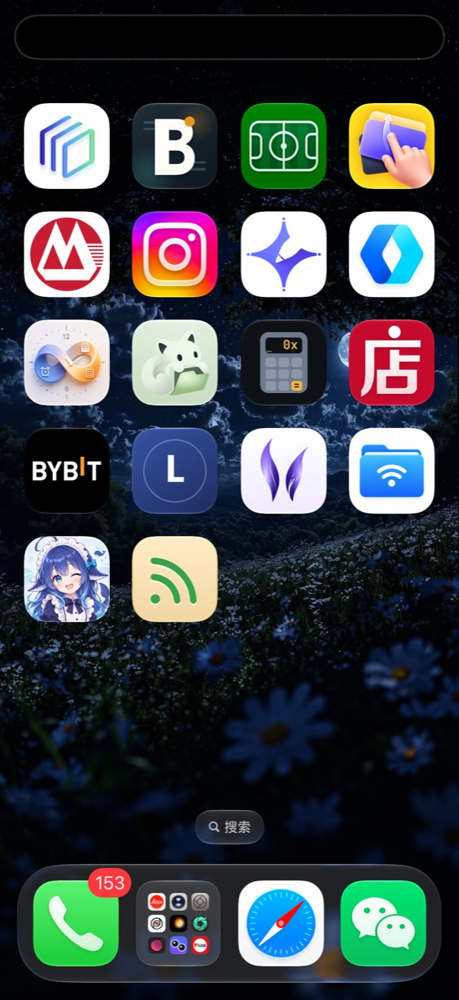
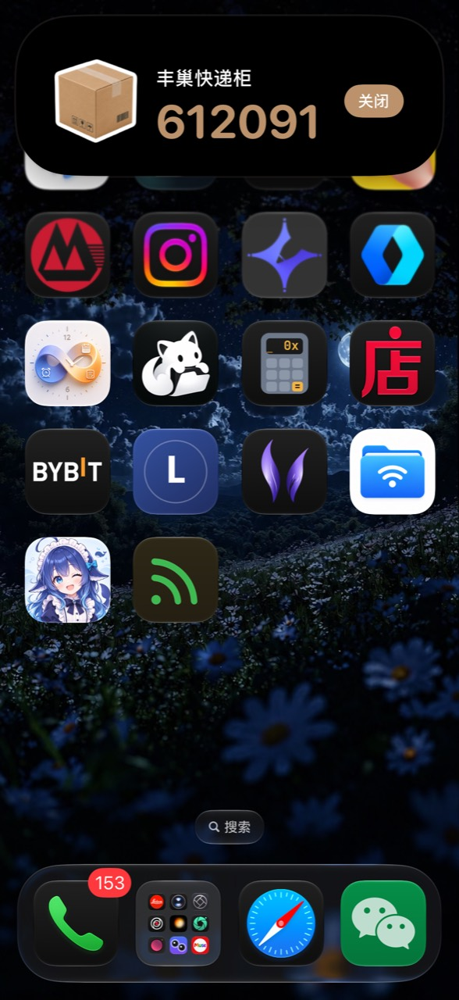
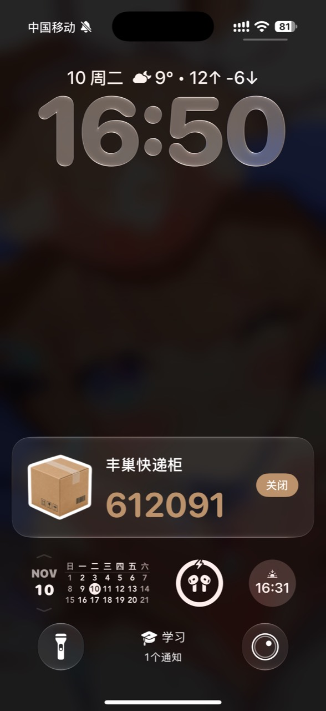
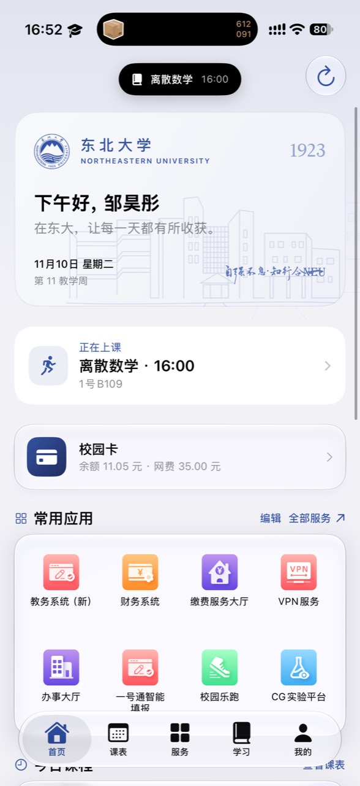
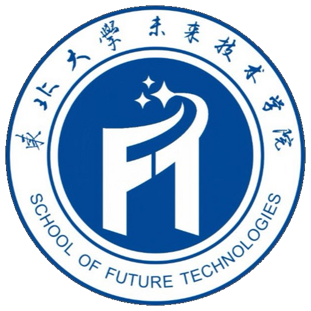

# NEU-Lumen

<p align="center">
  
</p>

<p align="center">东北大学「一号通门户」的原生 SwiftUI 客户端</p>

<p align="center">
  <a href="https://github.com/ZHT0711/NEU-Lumen/actions/workflows/build-unsigned.yml"></a>
  <a href="https://github.com/ZHT0711/NEU-Lumen/releases/tag/nightly"></a>
  
  
</p>

NEU-Lumen 将统一认证、课表、校园卡、成绩、作业和校园服务集中在一个轻量的 iOS 应用中。项目不依赖第三方运行库，网络、会话和缓存均由 Apple 系统框架与项目内模块完成。

## 产品预览

下面是 iPhone 实机演示图：应用外由系统接管 Live Activity，应用内首页显示同款紧凑胶囊。完整图片保存在 [`docs/screenshots`](docs/screenshots)。

<p align="center">
  
  
  
  
</p>

每次构建也会在 Actions 产物中生成首页、课表、服务、学习和浏览器截图；打开最近一次 workflow 的 **Artifacts → NEU-Lumen-ui-preview** 即可查看完整演示集。

<p align="center">
  
  
  
</p>

- **应用内 Live Activity**：顶部灵动岛可展开，展示下一节课、校园卡余额或自定义内容。
- **应用外 Live Activity**：进入后台后由系统接管，显示在锁屏和支持灵动岛的 iPhone 上。
- **学院身份**：我的页面显示对应学院院徽；未来技术学院使用学院提供的正式院徽图片。
- **海洋之心彩蛋**：连续点击「走进东大」标题三次，查看团队致意并进入 [NEU-AquaCore](https://github.com/NEU-AquaCore)。

## 功能

### 校园信息

- CAS 统一身份认证，支持校内直连与校外 WebVPN。
- 首页仪表盘：问候、教学周、下一节课、校园卡、常用服务和校园资讯。
- 课表网格：周次切换、连堂合并、冲突分列、自定义日程、节假日与调课。
- 成绩：学期成绩、GPA、加权平均分、学分统计和教务网页同步。
- 校园卡：余额、月度流水、网费和电费。

### 学习与作业

- NEUCSECG、慕课、学习通分别展示课程、作业、截止日期和进度。
- 平台 Cookie 按校园账号隔离并写入系统钥匙串；应用重启后自动恢复。
- NEUCSECG 入口会自动完成「校园统一登录」按钮点击，再进入平台。
- 作业数据另存为账号隔离缓存；退出登录时一并清理学习平台会话。

### Live Activity

Live Activity 的配置入口是 **我的 → 配置应用外灵动岛**：

1. 选择下一节课、校园卡余额或自定义文字。
2. 保持「显示应用内与锁屏 Live Activity」开启。
3. 回到首页后，应用内顶部显示同款灵动岛；切到后台后由系统显示锁屏/系统灵动岛。

系统设置中如果关闭了 NEU-Lumen 的「实时活动」，应用会保留应用内显示，但系统不会显示应用外 Live Activity。

## 构建与下载

### Nightly

[打开 Nightly 预发布页](https://github.com/ZHT0711/NEU-Lumen/releases/tag/nightly) 下载最近一次通过检查的未签名 IPA。推送到 `main` 会触发构建；每日北京时间约 03:17 也会自动构建。

未签名 IPA 需要使用 Sideloadly、AltStore 或开发者证书签名后安装。

### 本地构建

需要 macOS 与 Xcode 16+：

```bash
bash build_ios_unsigned.sh
# build/NEU-Lumen-iOS-unsigned.ipa
```

也可以用 Xcode 打开 `NEU-Lumen.xcodeproj`，运行 `NEU-Lumen` scheme。最低支持 iOS 17.0；Live Activity 需要系统允许实时活动，系统灵动岛需要支持该硬件的 iPhone。

## 项目结构

```text
NEU-Lumen/
├── App/          应用入口、主题、路由和标签栏
├── Components/   玻璃卡片、学院徽章等通用组件
├── Core/
│   ├── Models/       课表、门户、成绩、作业和校园卡模型
│   ├── Networking/   HTTP、CAS、WebVPN、Cookie 和网页读取
│   ├── Persistence/  钥匙串、网页登录会话和本地缓存
│   └── Services/     SessionStore、PortalRepository、Live Activity
├── Features/     首页、课表、服务、学习、我的和网页浏览器
└── NEU-LumenLiveActivity/  锁屏与系统灵动岛 Widget Extension
```

核心职责保持分离：`SessionStore` 管理账号与会话，`PortalRepository` 管理业务数据，`PortalBrowser` 负责网页认证和平台同步，`DynamicIslandActivityManager` 管理 Live Activity 生命周期。

## CI 工作流

`.github/workflows/build-unsigned.yml` 会依次执行：

- Swift / Node / Python 解析回归测试
- 原生 Release unsigned IPA 构建
- 模拟器 UI 与浏览器检查（模拟器不可用时生成诊断并跳过，不阻塞每日构建）
- 编译日志告警检查
- IPA 与 UI 截图产物上传

模拟器验证使用临时数据夹具，不会把测试账号或测试数据打进发布包。

## 隐私与安全

- 密码只用于认证；勾选保持登录后，经系统钥匙串加密保存。
- 网页 Cookie、作业缓存和账号数据按学号隔离，均保存在本机。
- 不上传密码、不记录认证日志；退出登录会清除对应会话。
- 本项目是第三方个人工具，与东北大学官方无关。

## 相关项目

- [NEU-AquaCore](https://github.com/NEU-AquaCore)
- [NEUPortal](https://github.com/ZHT0711)
- [holiday-cn](https://github.com/NateScarlet/holiday-cn)

## 许可证与免责声明

项目中的学校名称、校徽、学院徽章和组织头像仅用于校园工具界面展示。请遵守学校相关服务的使用规定，不要将本项目冒充官方应用。
